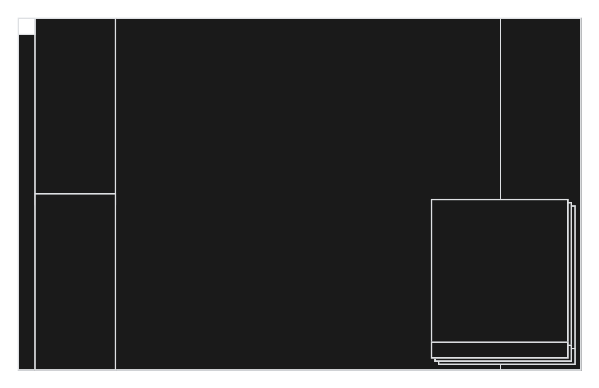

# 个人 AI 工作台设计规范

版本：1.2
日期：2026 年 10 月 15 日
设计方向：Factory + ASCII
适用范围：本机优先的全能画布与 OS 工作台外壳；手机适配暂不作为本轮交付前提。

本规范将 Factory 的克制工业感与 ASCII 的结构表达结合，服务于[全能画布需求](全能画布需求文档.md)定义的产品。它是本项目自己的设计规则，不是 Factory 官方设计系统的复制。开发循环依照[开发执行文档](开发执行文档.md)执行。

## 1 设计意图

像一个安静、有秩序的个人工作室：成果清晰，操作直接，助手随时可用。深色外壳承载项目与执行；浅色纸面用于文章和需要专注阅读的内容；ASCII 用于编号、路径、进度和关系。

页面首先回答：当前是什么文件夹或画布、主要内容是什么、下一步能做什么。系统信息按需展开，不能抢占成果空间。

## 2 视觉原则

- 黑白与暖灰构成主要界面，少量橙色表示正在执行或需要注意的动作。
- 层次由明暗、留白、文字等级和分隔线建立。
- 页面以一个主要工作区域为中心；辅助信息允许折叠。
- 控件偏平面、小圆角；不用霓虹、玻璃、渐变按钮或装饰光晕。
- 中文正文使用清晰的无衬线字体；等宽字体承担结构与技术元信息。
- ASCII 必须表达实际结构，不作为随机代码装饰。
- 文章观点、资产和任务状态必须来自真实数据；效果图里的文案不可直接作为运行状态。

## 3 颜色

以下是项目自定 token，源于参考风格后按应用需要调整。

| Token | 值 | 用途 |
| --- | --- | --- |
| --bg-canvas | #101010 | 全局画布 |
| --bg-sidebar | #141414 | 导航区域 |
| --bg-surface | #191919 | 编辑、输入、辅助面板 |
| --bg-hover | #242321 | 悬停与选中背景 |
| --bg-paper | #EEEEEA | 阅读与稿件纸面 |
| --text-primary | #EEEEEE | 深色背景主文字 |
| --text-secondary | #B8B3B0 | 次级正文 |
| --text-muted | #918A85 | 辅助信息，需按背景实测对比度 |
| --text-ink | #24231F | 浅色纸面正文 |
| --border-subtle | #30302E | 轻分隔线 |
| --border-strong | #77716B | 需要可辨识的控件边界，深色底上保持至少 3:1 |
| --accent-running | #EE6018 | 运行中小标记、关键进度 |
| --status-success | #A0CA92 | 小型成功标记 |
| --status-danger | #E88782 | 错误图标与提示 |
| --focus-ring | #EEEEEE | 键盘焦点 |

主要按钮采用浅色底与深色字，次要按钮为透明或深灰。橙色不铺满按钮或大卡片。成功不用大面积绿色，所有状态同时附文字或符号。细边框用于结构；可交互控件的识别与焦点需要足够对比度。

## 4 字体与文字等级

Latin 推荐 Geist 或 Inter；中文使用系统可用的 PingFang SC、Microsoft YaHei、Noto Sans SC；等宽区域使用 Geist Mono、JetBrains Mono 或系统等宽字体。字体许可、分发与加载在实现时核实，不依赖未取得许可的专有字体。

| 用途 | 字号 | 字重 | 行高 |
| --- | --- | --- | --- |
| 页面标题 | 26–28px | 400–500 | 1.25 |
| 区域标题 | 16–18px | 500 | 1.4 |
| 常规正文 | 14px | 400 | 1.5 |
| 控件与导航 | 13–14px | 400–500 | 1.4 |
| 元信息 | 12px | 400 | 1.5 |
| 文章正文 | 16px | 400 | 1.75 |

标题不使用营销页的超大字和整屏粗体。英文可轻微收紧字距；中文保持正常字距，不能直接套用英文负字距。文章宽度约 60–75 个字符，采用独立阅读排版。

## 5 间距与形状

间距基于 4px：4、8、12、16、24、32、48。常规面板内距 16–24px，关联元素间距 8–12px，独立区域间距 24–32px。

按钮和输入圆角 3–4px，普通面板 4–8px；浮层可用 8px。药丸只用于确有需要的紧凑标签，不能让所有控件都变成胶囊。

边框通常 1px。阴影只用于需要覆盖层级的浮层，保持轻微。没有阴影也应能理解页面结构。

## 6 画布底层与可配置窗口

### 6.1 空间关系

全能画布铺满应用内容窗口的底层，始终保持连续。分割区、停靠面板、浮动窗口和悬浮图标位于其上方；分割的是上层工作区，不把底层画布切成多个独立画布，也不让画布仅限于中央剩余矩形。面板可不透明，“悬浮其上”描述层级，不要求玻璃或半透明视觉。

画布缩放和平移只影响作品内容；面板和图标保持屏幕尺寸与位置。面板关闭、移动或收起后露出原有画布区域，不重排或挪动作品。面板获得输入时不误触底层；露出的画布区域可正常操作。

### 6.2 窗口形态

页面可横向、纵向分割并嵌套，拖动分隔条调整大小。所有业务面板遵循统一窗口规则：可拖入分割区停靠，可脱离成为浮动窗口，可收为可拖拽悬浮图标并重新展开，也可在应用内置顶。切换形态保留面板身份、输入、选择和任务状态。

默认置顶指应用内部高于普通面板，不盖住必要的模态确认；跨其他软件的系统级置顶待单独确定。窗口拖拽移动与窗口内容拖拽分开，调整大小遵守可操作的最小尺寸。小窗口或显示器变化后仍保留可找回的标题栏/图标及重置入口。

### 6.3 默认配置与参考图



默认配置采用图中空间关系：最左窄图标栏、左侧上下两个区域、中央大面积画布露出区域、右侧纵向区域，以及右下角重叠浮动窗口。截图用于定义默认布局；各区域的具体业务用途、精确比例、初始浮窗数量及图标含义尚未命名，不凭空绑定为资产、对话或任务。

截图的粗亮线用于表达边界，实际样式沿用本文 token、常规 1px 边框与低调层级。图外白边不视作应用必须保留的内边距。

### 6.4 配置保存与恢复

允许保存、命名、切换窗口配置并恢复默认。配置包含分割结构、比例、面板身份与状态、浮窗位置尺寸、置顶顺序和图标位置；与画布作品分开保存。切换布局不取消任务、不丢未提交输入、不写入画布撤销历史。

窗口尺寸改变时按比例与最小尺寸恢复，越界面板移回可访问范围；缺失面板类型显示可恢复占位，保留其配置。重置布局不能删除画布内容。

### 6.5 开发顺序

先开发全能画布，仅提供必要操作面板并预留上述分层与输入边界。完整分割、停靠、浮窗和布局预设随 OS 外壳阶段交付，不作为画布首版前置工程。保留 OpenPencil 编辑能力，通过主题和外壳适配本文风格，不为统一样式重写其编辑器。

## 7 ASCII 表达

推荐字符：

```text
[01] 图片实验室
[+] 新建项目
>_ 输入指令
资料 -> 试验 -> 结论
[====......] 4 / 10
assets/
├─ references/
├─ outputs/
└─ notes/
```

ASCII 是可选的轻量视觉语言。已知可计量总量才能展示百分比或进度条；未知进度显示“运行中”与最近真实事件，不虚构推进数值。

目录树来自真实数据，可点击节点使用正规的控件语义。流程线只表达真实依赖，节点位置不代表执行先后。屏幕阅读器使用简短可访问描述，装饰字符隐藏。全局背景不使用随机字符雨。

## 8 组件

| 组件 | 规则 |
| --- | --- |
| 主要按钮 | 浅色底、深色字，每个上下文清楚指向主要动作 |
| 次要按钮 | 中性边框或文字，不与主要动作争夺强调 |
| 输入框 | 深色底、明确边界，焦点可见，错误信息靠近字段 |
| 对话入口 | >_ 提示、作用域、输入和发送；历史按需展开 |
| 项目条目 | 名称、真实预览、简洁状态；整块点击与菜单动作不冲突 |
| 状态标签 | 小标记与文本，颜色仅辅助 |
| 文件列表 | 文件名、类型、必要版本和操作，不仅依赖扩展名 |
| 阅读纸面 | 浅底深字，充分行距；可切换深色阅读 |
| 执行日志 | 时间、任务、动作、结果；技术细节展开查看 |
| 对话/界面操作 | 共享业务接口，成功状态以真实结果为准 |

任何列表和任务视图都需要 loading、empty、error、partial、ready 等相关状态。示例按钮不是默认功能承诺；是否显示取决于能力与授权。

## 9 执行与错误呈现

排队显示“排队中”，运行显示当前动作，等待用户显示待决问题。取消请求与实际停止区分；中断显示恢复或对账入口；未知外部结果显示“结果待核实”，不给假成功图标。

任务成功与验证通过分别呈现，验证详情在需要时展开。提供成果入口和继续操作，不将底层模型事件直接转为业务完成。

插件启用、恢复等高影响动作显示实际版本和结果。恢复按钮只在系统具备对应能力时可用，不能作为视觉装饰。

## 10 动态页面与可访问性

动态页面复用本规范的组件和 token，不能按每次生成临时改变主题。优先通过可信组件配置布局，新代码遵守候选构建与验证流程。

保存视图、选中资产与版本，生成失败可以恢复默认页面。新视图的颜色、密度、状态和作用域不得破坏稳定外壳。

常规文字对比度目标至少 4.5:1，大字号文字及必要图形按适用标准验证；控件焦点明显。键盘可完成导航、切换项目、发送指令和打开成果。尊重减少动画设置，不使用持续闪烁光标或状态动画。状态变化提供适度的可访问通知。

## 11 实现与验收

通过 CSS 变量统一 token，通过共享组件统一状态和交互。ASCII 内容采用合适的等宽排版；逻辑与数据不写死在视觉模板。

视觉验收检查：

- 当前项目、主要成果和下一步是否一眼可辨。
- 主操作与对话是否清楚且不遮挡内容。
- 字体、间距、边框和状态是否统一。
- 是否存在不必要嵌套卡片、大标题、光晕或过多强调色。
- 图像预览、稿件、表格是否适合实际阅读。
- 空、失败、取消、中断和未知结果是否有真实状态。
- 小窗口与键盘操作是否可用。
- 运行截图是否来自真实数据，示意与模拟是否明确标识。

验收使用真实运行页面和交互，概念图只用于方向参考。画布首版使用必要且稳定的控件，完整窗口管理随后实现。窗口布局验收需包含拖拽、缩放、图标化、置顶、重启恢复和底层画布状态保持。

## 12 参考与变更记录

- [Refero 的 Factory 风格提炼](https://styles.refero.design/style/13d6fc89-eba2-4724-ac37-20f4f2e5efec)：借鉴黑白对比、轻字重、留白和少量状态色。该页面包含解释性建议，并非官方产品规范。
- [本项目 Factory + ASCII 概念图](../output/product-concepts/06-factory-ascii-home.png)
- [用户默认布局参考图](design/workspace-default-layout.png)

概念图中的日期、计数和状态为示意，部分相互不一致；不作为数据与验收依据。该方向取代之前荧光绿、玻璃浮层的视觉方案。旧效果图保留作为历史探索。

v1.0：建立项目自己的 Factory + ASCII 规则。用户后续提出的具体偏好优先，设计变更应同步更新本文件。

v1.1：历史版本加入手机及多端适配讨论；这些不再是本机画布首期前置要求。

v1.2：恢复沿用 Factory + ASCII 视觉规范，以用户截图更新为底层全窗口画布和上层可配置窗口。旧项目主页、固定侧栏和 M0 页面限制由本版替代。
