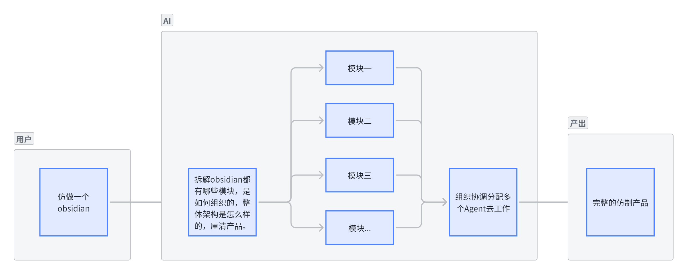
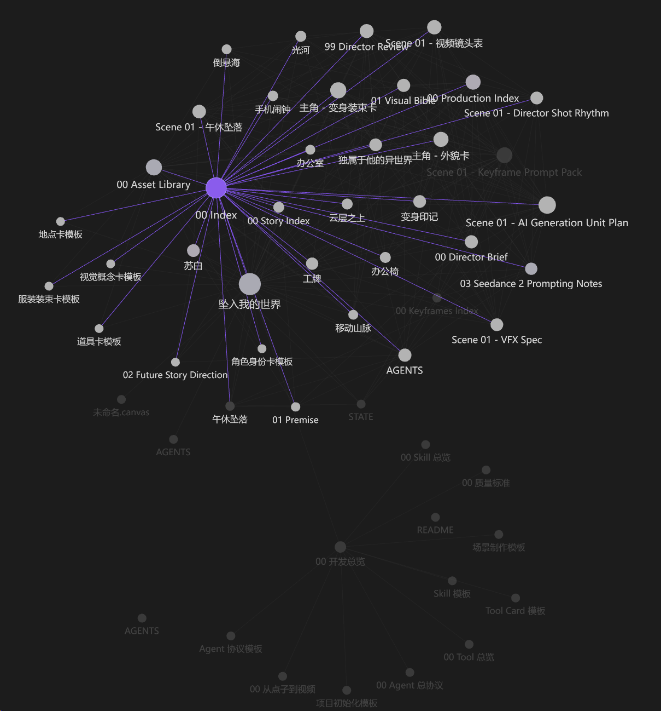

# 软件主动探索与功能依赖图谱交接

整理日期：2026年10月16日。面向接续讨论的产品、架构与开发 Agent。

本文整理本轮对话的背景、用户意图、方案演进和待确定事项，不是逐字聊天记录，也不是已批准的开发执行计划。当前请求是整理交接文档；尚未安装或运行 REA、探索 Obsidian、实现图谱系统或启动开发 Agent。本文不修改当前仓库既有开发计划。

## 核心意图

用户希望构建这样一种工作方式：用户只需说“我想仿做这个软件”，Agent 就主动、尽可能全面地体验和调查参考软件，发现功能及隐藏依赖，生成一张可交互的完整地图。用户可以从软件整体逐层展开到大模块、小模块和具体功能，查看节点之间的连接；选中一个功能时，系统关联实现它所需的所有支撑能力。随后依据选定范围制定计划、拆分任务、协调多个 Agent 开发。

这张地图应同时帮助用户理解产品、帮助 Agent 理解工作范围。用户无需先具备技术知识，也无需先列出完整需求。

“产品功能与依赖图谱”是讨论中提出的暂定名称，尚未确定正式名称。它结合层级拆解和跨模块依赖，不只是展示内部代码结构的架构图。

## 用户表达与明确偏好

用户指出，开发小白往往只能表达一种感觉：觉得某个软件很好，或者喜欢其中的白板和关系图谱，但无法说清具体涉及哪些功能。看似两个功能，实际可能牵涉软件的大部分核心能力。

用户最后明确描述的方向是：

> “agent去完整的主动体验参考软件，发现功能与隐藏依赖，给出一个非常完整全面的可视化的‘图’”

> “由一个软件拆分几个大模块拆分更多的小模块再更细致，各个节点有依赖有连接”

> “选中某一个比如白板，他会关联所有需要开发的模块，这样用户清晰，agent也清晰，后面再根据这些内容做计划拆模块分配agent开发”

因此，接续方案应保留以下优先级：

- 先由 Agent 主动探索和建立地图，再由用户在图上理解与选择。
- 不能要求用户在入口处先列出完整功能或技术架构。
- 调查对象是软件整体；用户提到的局部体验可以作为线索，但不应自动缩窄为只分析那几个功能。
- 图中既要呈现逐层拆分，也要呈现依赖与跨模块连接。
- 选择功能后应关联其支撑能力，不能仅高亮视觉上相邻的节点。
- 图谱最终要能支撑开发计划和多 Agent 分工，而非停留在展示层。

## 讨论如何演进

| 阶段 | 讨论内容 | 接续时应保留的结论 |
| --- | --- | --- |
| 软件与开源 | 用户询问 Obsidian 是否开源 | Obsidian 软件本体闭源，笔记使用开放的本地文件格式；两者要区分 |
| REA 能力 | 用户询问能否给 REA 一个软件并得到相同软件代码 | REA 提供分析能力，AI 使用分析结果编写和验证实现；不能保证一键恢复完整原始仓库 |
| 初始流程图 | 用户提出拆解软件、分模块、协调多 Agent、产出完整产品 | 用户关注从软件理解到自动开发的完整流程 |
| 流程补充 | 助手提出范围、接口、集成验收和反馈闭环 | 这些是方案建议；用户随后纠正了先让用户明确范围的前提 |
| 小白需求 | 用户指出用户无法表达完整功能和底层依赖 | 系统需要承担需求发现与依赖推导 |
| 最新方向 | 用户希望先主动全面调查并产出交互图谱 | 图谱成为用户选择范围与 Agent 后续执行之间的连接 |

早期助手曾建议通过少量问题或原型先确认用户需要哪些功能。用户进一步提出的图谱优先方向，应作为接续设计的主线，不应退回到让小白先填写详细需求清单。

## REA 在系统中的位置

REA 是候选分析工具层。根据对话中查阅的官方说明，它通过 MCP 和 CLI 向 AI 提供逆向分析能力。JavaScript／Electron 分析可提供模块、导入及相关关系；原生分析可结合相应工具提供伪代码、汇编和调用信息。AI 根据这些发现解释行为、编写实现并测试。

REA 不能独自承担主动体验、完整需求发现、图谱建模、多 Agent 协调和产品交付。界面操作、文档阅读、样例数据和代码分析需要组合使用。实际分析能力取决于目标文件、环境和工具配置。

本轮讨论保留了两个能力边界：分析结果不等于原始开发仓库；本地客户端文件也不能直接提供远端服务的完整实现。讨论中的“仿做”目标是复现所需功能与体验，不能把“完全相同”作为未经验证的结果承诺。

REA 的安装和分析命令在聊天中仅作说明，未执行。后续接入时应重新检查当前官方文档。

## 图谱的建议组成

以下为助手提出的设计建议，用户尚未逐项确认。

### 层级和关系

图谱应允许从产品整体展开至功能域、功能、具体交互和支撑能力。包含关系与依赖关系应明确区分；公共能力使用共享节点，避免在每个功能下面复制一份而失去关联。

以 Obsidian 为参考的候选拆解如下。它用于说明建模方式，不是已验证的 Obsidian 内部架构。

```text
参考软件
├─ 笔记
│  ├─ 创建与编辑
│  ├─ 内容渲染
│  └─ 文件引用
├─ 白板
│  ├─ 画布操作
│  │  ├─ 平移与缩放
│  │  ├─ 框选与多选
│  │  └─ 拖动与调整尺寸
│  ├─ 卡片
│  │  ├─ 文本卡片
│  │  ├─ 笔记卡片 → 文件引用、内容渲染
│  │  └─ 图片卡片 → 附件管理
│  ├─ 连线与分组
│  └─ 保存与恢复 → 数据存储
└─ 关系图谱
   ├─ 关系提取 → 链接解析、关系索引
   ├─ 图布局
   ├─ 筛选
   └─ 节点交互 → 笔记定位与打开
```

### 功能选择与依赖关联

选中白板后，系统应沿必需依赖继续递归追踪。例如白板包含笔记卡片，笔记卡片依赖内容渲染，内容渲染可能进一步依赖附件解析。关联范围不能只限于一层。

建议区分用户主动选择、自动纳入的必需依赖、可选增强和待调查关系。右侧详情应解释为什么纳入某个能力，以及取消它会影响哪些体验。

示例说明：“已选择白板全部功能。由于包含笔记卡片，需要加入笔记读取与内容渲染。如果取消笔记卡片，可以缩小实现范围。”

必需性需要结合目标体验和实现方案判定，不能把参考软件现有的全部依赖直接视为新项目唯一可行的实现。

### 证据与不确定性

观察到的产品行为、推断出的内部实现和新项目设计决策应分别记录。比如“白板可以显示笔记”可以来自操作证据，而“新项目采用某种索引服务”属于实现选择。

建议节点详情包含：功能说明、操作场景、证据、已确认事实、推测、未知项、子功能、依赖与验收条件。

用户期待全面探索；系统需要以探索记录和覆盖情况支撑这种全面性。未知、不可访问或尚未验证的部分应可见，不能用一张看起来完整的图掩盖调查缺口。

### 可视化与导航

用户提供了关系网络截图作为表达参考：节点以连线关联，选中节点突出相关连接，其余内容淡化。它表达图形探索与关联高亮的意图，并非已经确认的界面规格。

助手建议同一份数据支持整体图谱、层级展开和所选功能的局部依赖视图，以便大量节点仍可读。具体布局、交互方式和图形技术尚未选定。

## 从图谱到开发的建议流程

```text
用户给出参考软件和模糊意图
          ↓
Agent 主动探索软件整体
界面体验、文档、样例数据、必要的 REA 分析
          ↓
建立功能与依赖图谱
逐层拆解、关联证据、标注未知与覆盖情况
          ↓
用户在图上探索与选择
系统解释并关联必需依赖
          ↓
形成目标产品方案
模块边界、接口、数据模型、验收标准
          ↓
形成开发任务与任务依赖
协调多个 Agent 按依赖开发
          ↓
集成与对照验证
问题回到调查、设计或实现阶段
          ↓
交付可运行软件、源码、验证结果和已知差异
```

功能图谱与开发任务图有关联，但不能简单一对一转换。一个功能可能需要多个任务，多个功能也可能共享同一个基础模块。进入并行开发前，应明确接口与依赖，防止各模块独立完成却无法集成。

助手还建议将开发和验证状态回写功能图谱，让用户看到已实现、等待依赖或验证失败的功能。协调 Agent 应贯穿整个开发过程，处理依赖、集成和返工。这些细节仍属于待深化方案。

## 尚未确定的问题

- 产品最终名称、使用形态，以及是否作为当前工作台的一项能力接入。
- 第一版具体支持哪些软件类型、平台和调查渠道。
- 如何组织主动探索，记录已访问路径、构造样例并判断覆盖程度。
- 如何表示节点类型、关系类型、证据、版本与不确定性。
- 如何区分必需依赖、可替代实现和可选增强，如何处理循环关系。
- 图谱拆解的粒度，以及何时停止继续拆分。
- 用户选择范围后，图谱如何转化为任务、验收条件和 Agent 工作上下文。
- 多 Agent 的隔离、接口协作、合并、失败恢复和共享状态机制。
- 时间与成本预算、探索停止条件，以及无法调查部分的呈现方式。
- REA 对实际参考软件的有效程度，尚需实测。

这些是后续系统设计需要解决的问题，不应一次性全部交给小白用户回答。Agent 应先调查并给出具体方案，再让用户判断涉及产品体验和范围的选择。

## 给接续 Agent 的阅读提示

接续时应围绕“主动探索 → 功能与依赖图谱 → 用户选择 → 开发执行”继续深化。当前最重要的设计对象是图谱及其产生过程，而不是立即开始写一个 Obsidian 仿品。

不要把 Obsidian 示例当作已确认的软件架构，不要把助手提出的字段和视图当作用户已经批准的最终规格，也不要把 REA 等同于完整系统。后续是否开始原型、实测或编码，应结合新的任务指令确定。

## 原始视觉参考

第一张图描述用户最初的流程：仿做 Obsidian，AI 拆解软件与模块，协调多个 Agent，产出完整产品。



第二张图表达用户希望的关系图谱体验：节点之间有连接，选中节点后显示相关关系。图内的内容是视觉参考，不是本项目的功能数据。



## 对话中查阅的来源

- [REA 官方仓库与说明](https://github.com/morluto/rea)：工具定位、快速入门、分析产物和限制。
- [Obsidian 官方论坛关于闭源的说明](https://forum.obsidian.md/t/porting-obsidian-to-c-and-legal-issues/88534/2)。
- [Obsidian 数据存储说明](https://obsidian.md/help/data-storage)：本地笔记存储。

来源用于支持背景信息；本文提出的图谱系统是本次讨论形成的产品设想，不代表 REA 已经提供这些完整能力。
